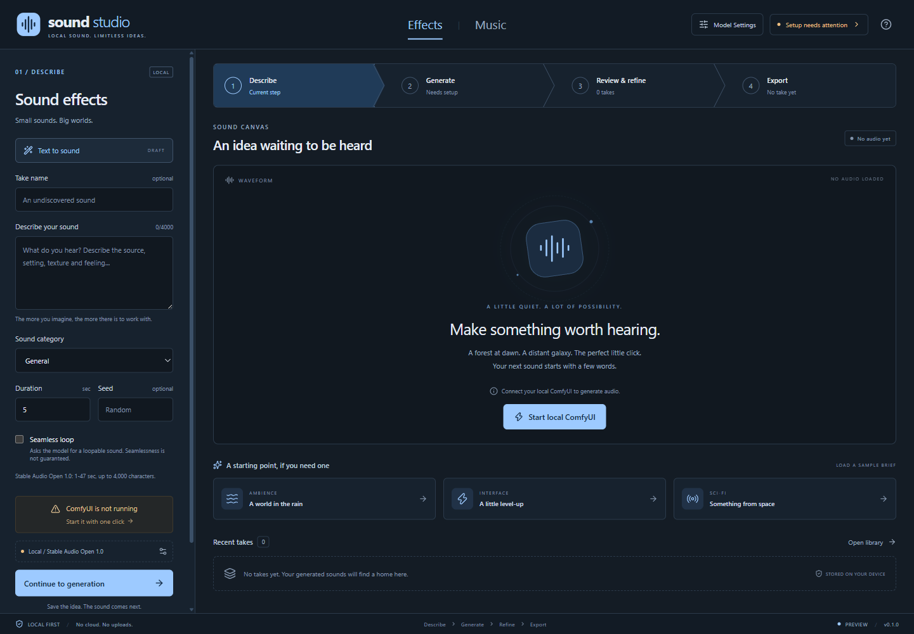
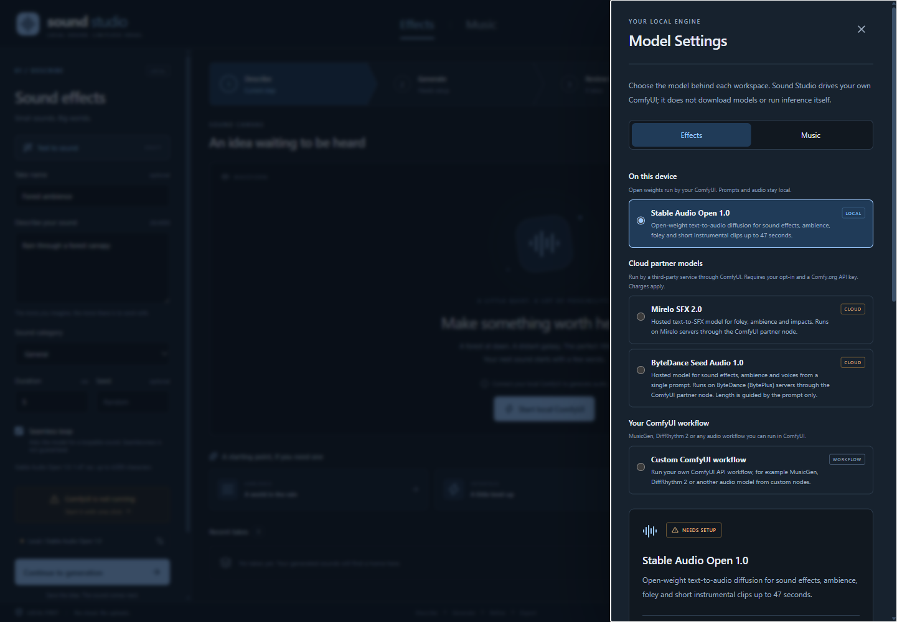
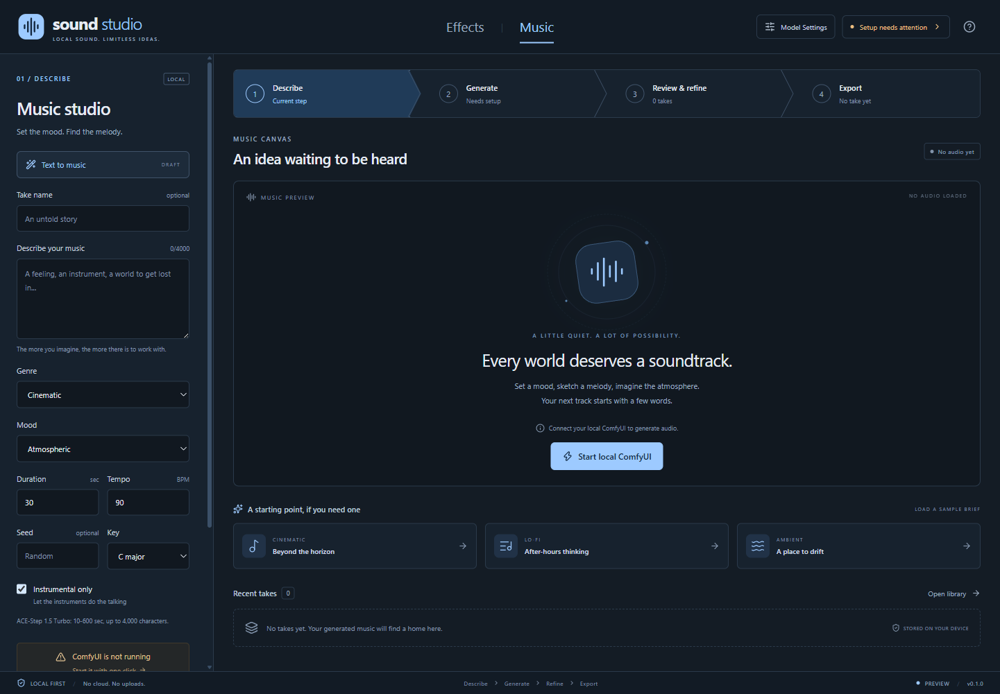
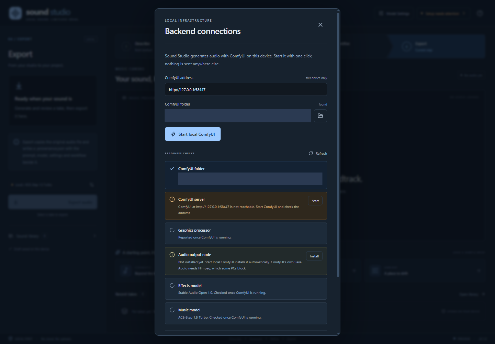

# Sound Studio

## Imagine the sound. Set the mood.

**A local-first home for AI sound effects and music, built for the worlds you create.**

Sketch the crackle of a campfire, the perfect interface chime, or the soundtrack to somewhere new. Sound Studio gives you two creative workspaces in one blue-toned desktop application, inspired by [Character Studio](https://github.com/rwrife/CharacterStudio). Generation runs on **your own [ComfyUI](https://github.com/comfyanonymous/ComfyUI)** on this device.

**Early preview.** Sound Studio does not bundle or download models. It drives a ComfyUI that you install; Sound Studio can start it for you with one click. Without one, you can still draft and save ideas, but nothing is generated.

[Get started](#getting-started) | [Features](#features-at-a-glance) | [Models](#models) | [Future directions](#future-directions) | [Full guide](GUIDE.md)



*The actual Effects workspace before connecting to ComfyUI.*

## Features at a glance

| Shape the small details | Set the bigger scene |
|---|---|
| **Effects workspace.** Describe ambience, foley, interface sounds and more, with category, duration, seed and loop intent. | **Music workspace.** Set genre, mood, duration, tempo, key and lyrics when your model can sing. |
| **Generate on your machine.** Sound Studio can start your ComfyUI for you, send it a validated workflow, follow its progress and cancel at any time. | **Hear every take.** Play takes, see waveforms drawn from the real audio, and compare recent takes. |
| **Export with provenance.** Copy the original file and a `.provenance.json` that records the prompt, model, settings and workflow. | **Ideas that stay with you.** Drafts, takes and model choices stay on this device and survive restarts. |



*Model Settings groups models by where they run. Cloud partner models stay off until you opt in.*

## Models

| Workspace | Runs on this device | Cloud partner (opt-in) | Your workflow |
|---|---|---|---|
| Effects | Stable Audio Open 1.0 | Mirelo SFX 2.0, ByteDance Seed Audio 1.0 | Any ComfyUI audio workflow |
| Music | ACE-Step 1.5 Turbo, ACE-Step v1 3.5B, Stable Audio Open 1.0 | None | MusicGen, DiffRhythm 2 and other custom nodes |

- **On this device:** open-weight models run by ComfyUI's built-in nodes. Download them yourself; Model Settings shows where each file goes and checks that ComfyUI can see it.
- **Cloud partner models:** run by a third-party service through ComfyUI partner nodes. They need your explicit opt-in and a Comfy.org API key, encrypted on this device. Charges apply, and an estimate is shown before you generate.
- **Your workflow:** export any working ComfyUI audio workflow in API format, add placeholders such as `{{prompt}}` and `{{seconds}}`, and import it.



*The actual Music workspace, with ACE-Step 1.5 selected and no ComfyUI connected.*

## Basic requirements

- Node.js **22.12 or newer** and npm.
- A desktop environment supported by Electron. Development and testing happen on Windows; other platforms are not yet verified.
- To generate, a recent [ComfyUI](https://github.com/comfyanonymous/ComfyUI) running on this device, plus at least one model. Local models need a capable GPU; ACE-Step 1.5 suggests about 12 GB of VRAM.

## Getting started

From the repository root in PowerShell:

```powershell
npm install
npm run dev
```

Sound Studio looks for ComfyUI when it opens. If it is not running, choose **Setup needs attention** in the header (or **ComfyUI is not running** in the side panel) to open **Backend connections**. If ComfyUI is installed in a usual place such as `%LOCALAPPDATA%\ComfyUI`, choose **Start local ComfyUI**: Sound Studio starts it on this device and connects. Otherwise choose your ComfyUI folder (a portable build or a source checkout with a virtual environment), or start ComfyUI yourself and enter its address. Then follow the **Readiness checks** until each one is ready.



*Backend connections on a first run, before ComfyUI is started. The folder path is masked.*

On some PCs ComfyUI's own audio saving cannot load FFmpeg. Starting ComfyUI from Sound Studio installs a small WAV output node into its `custom_nodes` folder so takes save anyway. See the [guide](GUIDE.md#audio-output-node).

For a production build:

```powershell
npm run build
npm start
```

On Windows, `.\Start-SoundStudio.ps1` also opens an existing build. A browser-only UI preview, which cannot generate, is available with `npm run dev:web`.

See the [guide](GUIDE.md) for model setup, cloud access, custom workflows, storage and troubleshooting. Contributor and coding-agent conventions are in [AGENTS.md](AGENTS.md).

## Future directions

These are goals, **not shipped capabilities**:

- Guided model downloads from the readiness checks.
- Variations, inpainting and loop refinement for existing takes.
- Audio import, a searchable asset library and project files for game and media projects.

The foundation is intentionally small: describe the idea, generate it on your own hardware and keep the record of how it was made.
