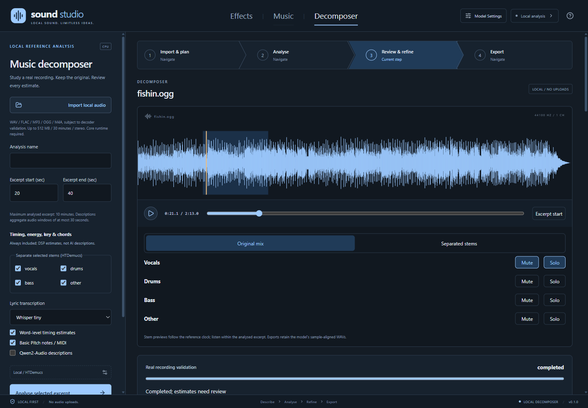

# Sound Studio

## Imagine the sound. Set the mood.

**A local-first home for AI sound effects and music, built for the worlds you create.**

Sketch the crackle of a campfire, the perfect interface chime, the soundtrack to somewhere new, or a breakdown of a song you want to study. Sound Studio brings three creative workspaces into one blue-toned desktop application, inspired by [Character Studio](https://github.com/rwrife/CharacterStudio).

**Local audio study, with generation still a shell.** Decomposer imports existing recordings, plays real waveforms, runs local analysis, saves reviewed results and exports available artifacts. Effects and Music are still editable drafts: **no audio generation is implemented**. Models are not bundled; optional analysis profiles require explicit downloads.

[Get started](#getting-started) | [Features](#features-at-a-glance) | [Future directions](#future-directions) | [Full guide](GUIDE.md)


*The actual Effects shell. The canvas is an empty placeholder, not a generated waveform.*

## Features at a glance

| Shape the small details | Set the bigger scene |
|---|---|
| **Effects workspace.** Draft ambience, foley, interface sounds and more with category, duration, seed and loop intentions. | **Music workspace.** Explore a musical direction with genre, mood, duration, tempo and instrumental intentions. |
| **Decomposer workspace.** Import a recording, study timing/harmony and optionally run local stem, lyric, MIDI and audio-description models. | **A familiar creative flow.** Import and plan, analyse an excerpt, review the evidence, then export or send a reviewed brief to Music. |
| **A little inspiration.** Load sample briefs and breakdowns and make them your own. | **Ideas that stay with you.** Independent drafts survive tab changes, settings dialogs and application restarts on the same device. |


*The actual Music shell. Generation and audio controls are deliberately unavailable until a backend exists.*



*Actual Decomposer playback after local HTDemucs separation. The recording is [Let's Go Fishin' by Karissa Hobbs](https://freemusicarchive.org/music/Karissa_Hobbs/Age_of_Flowers/09_Lets_Go_Fishin), [CC BY 3.0](https://creativecommons.org/licenses/by/3.0/), via the [librosa example collection](https://librosa.org/data/audio/Karissa_Hobbs_-_Lets_Go_Fishin.txt). No audio files are included in this repository.*

Decomposer preserves the original, raw machine results and your corrections separately. Reopen analyses in its local library; export available stems, MIDI, timestamped lyrics, JSON and Markdown with source hashes and model provenance. A Music handoff asks before changing your existing draft.

**Model limits matter.** Estimates and sung lyrics need review. The optional Qwen2-Audio description profile requires a large download and substantial CPU RAM; real caption inference is **unverified on the development machine**. See the [guide](GUIDE.md) for supported profiles, hardware limits and validation boundaries.

## Inside the shell

- **Slate-blue design.** Dark neutral canvases, blue-gray settings panels and pale-blue accents.
- **Visible boundaries.** Decomposer reports runtime readiness and real job failures. Missing models never produce pretend output; generation remains clearly unavailable.
- **Keyboard-friendly navigation.** Arrow-key workspace tabs, labeled controls, modal focus containment and Escape-to-close dialogs.
- **Local by default.** Drafts remain in the application profile. The renderer has no Node.js or unrestricted filesystem access.

## Basic requirements

- Node.js **22.12 or newer** and npm.
- A desktop environment supported by Electron. The initial shell is developed and exercised on Windows; other platforms are not yet verified.
- No GPU, Python environment or AI account is needed for drafts. Decomposer's managed CPU runtime currently supports Windows x64, including x64 emulation on ARM64, and installs separately without changing global Python.

## Getting started

From the repository root in PowerShell:

```powershell
npm install
npm run dev
```

For a production build:

```powershell
npm run build
npm start
```

On Windows, `.\Start-SoundStudio.ps1` also opens an existing build. A browser-only UI preview is available with `npm run dev:web`.

For audio analysis, open **Model Settings > Decomposer** and explicitly install the core runtime, then any optional model profiles. No audio is uploaded; inference uses local files only. See the [guide](GUIDE.md) for storage, limits and development commands. Contributor conventions are in [AGENTS.md](AGENTS.md).

## Future directions

These are goals, **not shipped capabilities**:

- Local text-to-sound and text-to-music generation.
- GPU execution profiles and broader platform/runtime support.
- Sample-accurate mixing, richer arrangement editing and variation comparison.
- Portable project files and a searchable cross-workspace asset library.

The studio helps shape future sounds and study existing recordings without pretending that an estimate is musical truth.
