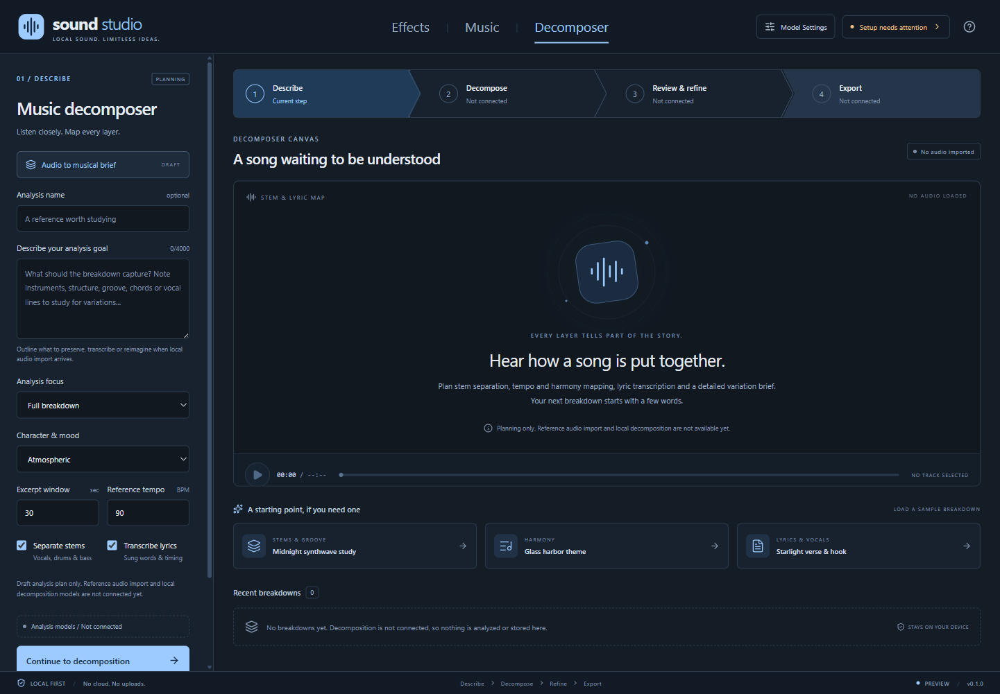

# Sound Studio

## Imagine the sound. Set the mood.

**A local-first home for AI sound effects and music, built for the worlds you create.**

Sketch the crackle of a campfire, the perfect interface chime, the soundtrack to somewhere new, or a breakdown of a song you want to study. Sound Studio brings three creative workspaces into one blue-toned desktop application, inspired by [Character Studio](https://github.com/rwrife/CharacterStudio).

**Early application shell.** You can write and save local drafts, explore workflows and plan your sound or song analysis. AI generation, music decomposition, model installation, playback, import and export are **not implemented yet**. No models are bundled, no inference services are contacted, and sample briefs do not produce or analyze audio.

[Get started](#getting-started) | [Features](#features-at-a-glance) | [Future directions](#future-directions) | [Full guide](GUIDE.md)


*The actual Effects shell. The canvas is an empty placeholder, not a generated waveform.*

## Features at a glance

| Shape the small details | Set the bigger scene |
|---|---|
| **Effects workspace.** Draft ambience, foley, interface sounds and more with category, duration, seed and loop intentions. | **Music workspace.** Explore a musical direction with genre, mood, duration, tempo and instrumental intentions. |
| **Decomposer workspace.** Plan reference-track breakdowns across stems, tempo, harmony, lyric transcription and variation briefs. | **A familiar creative flow.** Move from Describe to Generate or Decompose, Review & refine, and Export using a connected process stepper. |
| **A little inspiration.** Load sample briefs and breakdowns and make them your own. | **Ideas that stay with you.** Independent drafts survive tab changes, settings dialogs and application restarts on the same device. |


*The actual Music shell. Generation and audio controls are deliberately unavailable until a backend exists.*



*The actual Decomposer shell. Reference audio import, stem separation and lyric transcription are planned capabilities.*

## Inside the shell

- **Slate-blue design.** Dark neutral canvases, blue-gray settings panels and pale-blue accents.
- **Visible boundaries.** Model Settings, Backend connections and Sound library explain their placeholder state rather than pretending to be connected.
- **Keyboard-friendly navigation.** Arrow-key workspace tabs, labeled controls, modal focus containment and Escape-to-close dialogs.
- **Local by default.** Drafts remain in the application profile. The renderer has no Node.js or unrestricted filesystem access.

## Basic requirements

- Node.js **22.12 or newer** and npm.
- A desktop environment supported by Electron. The initial shell is developed and exercised on Windows; other platforms are not yet verified.
- No GPU, Python environment, AI account or model weights are required for this shell.

## Getting started

From the repository root in PowerShell:

```powershell
npm install
npm run dev
```

For a production build:

```powershell
npm run build
npm start
```

On Windows, `.\Start-SoundStudio.ps1` also opens an existing build. A browser-only UI preview is available with `npm run dev:web`.

The [desktop release workflow](.github/workflows/release.yml) prepares draft releases for Windows x64 and ARM64, macOS Apple Silicon and Linux x64. Packages are unsigned and contain only the shell; see the [packaging and release guide](GUIDE.md#desktop-packages-and-releases) for details.

See the [guide](GUIDE.md) for workflow details, local storage, development commands and current limitations. Contributor and coding-agent conventions are in [AGENTS.md](AGENTS.md).

## Future directions

These are goals, **not shipped capabilities**:

- Local text-to-sound, text-to-music and music-decomposition models, with explicit model downloads and hardware-fit guidance.
- Stem separation, tempo/harmony analysis, detailed musical captioning and lyric transcription to inform new musical variations.
- Real waveform previews, playback, variation comparison and loop refinement.
- Audio import, an organized asset library and export for game and media projects.
- Durable project files and output provenance, including the actual model, prompt and seed used.

The foundation is intentionally small: a place to shape the idea before connecting the engine.
