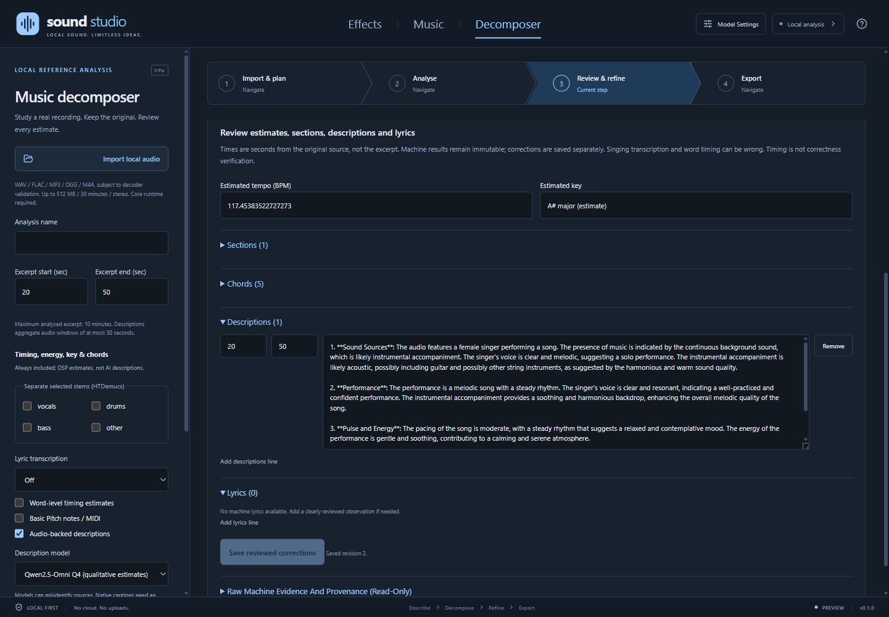

# Decomposer guide

## Scope

Effects and Music generate through the user's ComfyUI; see the [main guide](../GUIDE.md). Decomposer independently works on an existing recording: local import, waveform/playback, excerpt analysis, review, library reopening and exports. It does not create music or prove that a variation is legally reusable.

The managed analysis runtime initially targets **Windows x64**, including x64 emulation on Windows ARM64. Other operating systems can run the application shell but managed analysis setup is not implemented for them. The renderer-only browser preview cannot access desktop audio APIs.

## Install and run

Use Node.js 22.12+ and npm in PowerShell:

```powershell
npm install
npm run dev
```

`npm run build` type-checks and builds into `out`; `npm start` opens that build. `.\Start-SoundStudio.ps1` opens an existing build. `npm run dev:web` serves only the renderer at `http://127.0.0.1:5173`.

No Python or model is required just to edit drafts. For Decomposer, open **Model Settings > Decomposer**, install **Audio + timing / harmony**, then explicitly install any optional model profiles you need. The application does not modify global Python, PATH, or other worktrees.

## Decomposer workflow

1. **Import & plan:** choose a local WAV, FLAC, MP3, OGG or M4A. Extension is only a first filter; the actual decoder must accept the file. The original is copied intact into the app profile and SHA-256 hashed. A separate decoded WAV supports playback and waveform display. Limits are 512 MB, 30 minutes, one or two channels, and 8-192 kHz input. Unsupported, corrupt and external-reference files are rejected.
2. **Analyse:** select an excerpt of up to 10 minutes and the desired stages. Timing/energy/harmony DSP is always included. Optional stages require installed profiles. Analysis never silently installs a model. Jobs run serially with queued, running, failed, cancelled and completed states; selecting a workflow step is not execution.
3. **Review & refine:** audition the reference, seek, and use mute/solo for available stems. Edit tempo/key, timed sections, chord estimates, audio descriptions and lyric lines. Save reviewed corrections before exporting or changing the selected analysis. Raw machine results are retained separately. Timestamps are seconds from the original source.
4. **Export:** choose a directory. Each export creates a new uniquely named folder without overwriting existing files. Export only real available stem WAVs, MIDI, LRC/SRT lyrics, structured JSON or Markdown. Every export includes JSON provenance and both raw and reviewed results.

The analysis goal and sample cards are **text-only intent**. They are not fed back as acoustic evidence. Imported material must be material you are entitled to process.

### What the stages mean

| Stage | Output and limitations |
|---|---|
| Librosa timing / energy | Beat locations, tempo and RMS measurements from decoded audio. Tempo may be half/double time; silence or weak rhythm may yield no estimate. |
| Chroma harmony | Key and major/minor chord estimates, not authoritative notation. Complex voicings, detuning and dense mixes are difficult. |
| Section estimates | Conservative acoustic-change segments, not verified verse/chorus labels. |
| HTDemucs | Selected vocals/drums/bass/other WAVs from a four-source model. Selecting fewer output stems does not make the underlying inference cheaper. Bleed and artifacts are expected. |
| Whisper tiny/base | Local CPU-int8 transcription of the selected vocals stem when available, otherwise the explicitly labeled original mix. Input hash/model provenance is retained; a stem/decode error never silently falls back. Singing may be mistranscribed or hallucinated. Optional word timing is an estimate, **not correctness verification**. |
| Basic Pitch | Optional note/MIDI extraction. This is not a chord/key/beat estimator. Dense polyphonic mixes are difficult. |
| Qwen2.5-Omni-7B Q4 | Explicitly selected, timed qualitative observations about audible sources, performance, pulse/energy and changes. Compare against the audio: timbre, genre, roles and mood may be wrong. Requires the native profile described below. |
| Qwen2-Audio-7B-Instruct | Separate full-precision experimental profile; real inference remains unverified on the development host. No automatic substitution with native Omni. |

No calibrated confidence score is presented. Source time ranges, model/revision, options, stage elapsed time and warnings are preserved so reviewers can assess evidence.

Stem previews follow the reference clock and are not a sample-accurate DAW mixer. Exported stems retain their model sample alignment. Source/lyric timestamps are absolute; stem WAVs and MIDI begin at excerpt zero, with the original offset recorded in JSON.

## Runtime and model acquisition

The core installer downloads checksum-pinned **uv 0.6.17**, uses its managed **CPython 3.11.12 x64**, and installs pinned direct dependencies in an app-owned virtual environment. Optional profiles have separate requirements. See [`scripts/analysis`](../scripts/analysis) for exact dependency/model pins and license references.

Downloads are explicit and use upstream package/model services. Audio and prompts are never uploaded. After acquisition, the worker uses local model paths, offline Hugging Face settings, and a process-level network denial guard. No cloud fallback is implemented. The worker communicates with Electron over stdin/stdout, not a listening server.

Model Settings reports import/file readiness, the managed Python version and physical RAM. It does not claim measured GPU capacity or guaranteed inference success. CPU is the supported execution profile. Installation errors remain visible; cancellation stops the installation process tree and partial downloads are not treated as ready models.

| Profile | Approximate acquisition / hardware considerations |
|---|---|
| Core | Roughly 250 MB plus caches; no model weights |
| HTDemucs | CPU dependencies plus roughly 80 MB weights; CPU separation can be slow |
| Whisper tiny / base | Roughly 75 / 145 MB weights plus CTranslate2/PyAV dependencies |
| Basic Pitch | Runtime dependencies and a small note-transcription model |
| Qwen2-Audio 7B | 16.8 GB weights plus dependencies/caches; unchanged CPU guard requires 40 GiB total and 35 GiB currently available RAM. Unverified full-model inference. |
| Qwen2.5-Omni Q4 native | 6.23 GB weights + 41 MB pinned source; allow 15 GiB free disk during installation. Existing Git, Visual Studio x64 C++ tools and CMake/Ninja are required. Windows x64/AVX2, including supported emulation, and 10 GiB currently available RAM per inference window. |

The original full-precision Qwen2-Audio profile has **not been validated on the development machine**: it has 32 GiB physical RAM. The distinct quantized Omni profile has real-output evidence below; that does not validate Qwen2-Audio.

### Using native qualitative descriptions

Explicitly install **Qwen2.5-Omni Q4 qualitative descriptions**, enable **Audio-backed descriptions**, and choose **Qwen2.5-Omni Q4** in **Description model**. Existing/legacy selections stay on Qwen2-Audio until you change them. Setup builds checksum-pinned llama.cpp source plus the bundled compatibility patch using existing tools, runs native regressions, and retains exact build/binary/model identities. It never installs global tools. The upstream 7B Apache-2.0 LICENSE and the GGUF card's differing `qwen-research` metadata are both retained.

Select at least one real second, up to the normal ten-minute excerpt limit. Captions use mono 16 kHz windows of at most 30 seconds. A final remainder shorter than one second overlaps prior audio inside the excerpt; it is not padded or extended outside the selection. The corrected encoder preserves valid feature lengths. Every completed window records actual encoded token counts, source sample bounds, input hash, the formatted prompt, model/runtime/patch hashes, completion reason and measured timing/memory.

Each helper is owned by its job and is cancelled with it. DSP/other model processes exit before native caption loading. Limits remain **10 GiB available at launch, 8 GiB maximum process memory, 2 GiB minimum system availability, context 2048 and 300 seconds per window**, with `--no-repack`. The existing 60-minute worker limit also applies; long CPU excerpts may need shortening. The explicitly bounded response budget is **256 tokens**. A missing EOG, token-cap exhaustion, missing observation section or audio-token mismatch fails the job rather than publishing an incomplete description. Raw failed text/logs remain in private job diagnostics. There is no server, implicit download or cloud fallback.



*Actual stored output for the attributed Karissa Hobbs recording below, reopened in an isolated review-only desktop profile. Model weights are not needed to review/export saved results.*

### Bounded alternative-caption checks

The chronology below preserves failed feasibility checks as well as later useful output. CoNeTTE was not adopted. The unmodified native runtime was not adopted; only the corrected, guarded build and validated qualitative prompt are used by the explicit profile.

- **CoNeTTE:** stopped before checkpoint acquisition/inference. The upstream loader can invoke unrestricted `pickle.loads` on tokenizer extra state, its dependency pins conflict with the managed runtime, and default initialization has additional downloads. No loader safeguards were weakened. This is not a claim that the checkpoint is malicious.
- **Native Qwen2.5-Omni-7B Q4_K_M:** the official llama.cpp **b12064 ARM64 CPU** executable ran and exposed local audio input and `--offline`. Its archive and the two GGUF files (6,231,560,864 bytes combined) passed their pinned SHA-256 checks. A real 20-30 second excerpt of the attributed recording below decoded to 160,000 mono 16 kHz samples.

| Native attempt | Observed outcome |
|---|---|
| Initial preflight | Did not launch: 9.67 GiB available was below the conservative 10 GiB start budget. |
| Default weight repacking | Launched with 10.32 GiB available, then hit the 8 GiB process-memory stop after 5.735 seconds. Peak working set was 8.19 GiB; lowest system availability was 2.45 GiB. The owned process was terminated; output was empty. |
| Supported `--no-repack` allocation option | Completed in 40.906 seconds with **5.79 GiB peak working set** (6,216,237,056 bytes) and 5.35 GiB minimum system availability. Logs recorded actual audio-batch encoding in 6.36 seconds. Local model/audio paths, `--offline` and unreachable proxy settings were used. The output below failed the usefulness check. |

The last run solved the allocation problem **without relaxing** the 10 GiB startup budget, 8 GiB process stop, 2 GiB system-memory floor or five-minute timeout. Its raw caption was:

> The music is a lively instrumental piece in Bb major with a tempo of 175.0 bpm. It features a chord progression of Bb major, F major, and G# major, and a 4/4 time signature.

The prompt asked for voices, instruments, rhythm, texture and changes, with uncertainty, and explicitly prohibited invented exact key/BPM/notes. The response omitted the requested voice/instrument details, called the vocal validation excerpt instrumental, and asserted unsupported precise harmony/timing. **Successful local execution is not successful musical analysis.** This result was not promoted into the application or substituted for the original caption profile.

Three further controlled checks used the **same local model**, unchanged limits and `--no-repack`, explicitly enabling its embedded Jinja chat template. The GGUF template matched the pinned upstream template; native code places the audio before the question and wraps its embeddings with the matching audio begin/end tokens. Each input represented the same 20-30 second source interval: the full mix or the first 10 seconds of its already-separated 20-40 second vocals/other stem. Each received only this identical question: "Describe the sounds you hear. Is there singing? Which instruments or other sounds are audible?" No title, artist, expected answer, MIR estimate or previous caption was supplied.

| Input | Raw output | Wall time |
|---|---|---|
| Full mix | The audio contains music, but there is no singing. The instruments or other sounds are not specified. | 38.156 s |
| Vocals stem | The audio contains music, specifically a pop song with a female singer. There are no other sounds or instruments audible. | 38.907 s |
| Other stem | The audio contains a piece of music with a guitar and a harp. There is no singing. | 38.640 s |

All three completed with approximately 5.79 GiB peak working set and at least 5.38 GiB free system memory, with audio encoding/decoding recorded. **The path is audio-responsive and can detect isolated singing; it still misses singing in the same full mix.** Instrument naming, including "harp", was not independently verified.

A subsequent valid-length comparison found a concrete native preprocessing discrepancy. The pinned [native preprocessor](https://github.com/ggml-org/llama.cpp/blob/51fe42c5d14bfb9adf0612ff98a9ab79e0e7275c/tools/mtmd/mtmd-audio.cpp#L619-L640) emits fixed 3000-frame blocks without preserving their valid lengths; the 10-second inputs decoded **750 audio tokens**. The model-card-recommended [reference implementation removes masked padding](https://github.com/huggingface/transformers/blob/cb39f7dd5ba874ee1859b47283b08cd3a6ab5a0d/src/transformers/models/qwen2_5_omni/modeling_qwen2_5_omni.py#L2389-L2391) and computes output lengths from valid frames (about **250 tokens** for 10 seconds).

An exact-30-second control used contiguous source audio from 20-50 seconds, resampled to exactly **480,000 mono 16 kHz samples**, without padding or repetition in the probe. It completed in 72.468 seconds at approximately 5.79 GiB peak working set but returned the identical full-mix response above. Its native log showed **two 750-token chunks, totaling 1500 audio tokens**, rather than 750 valid tokens. The native preprocessor itself adds padding; its frame calculation yields 6001 frames at this exact input length and emits two complete blocks. A minimum/exact-30-second profile therefore does **not** solve the alignment discrepancy.

Those unmodified-runtime results cannot distinguish model limitations from native adapter errors. The source-level correction and separately evaluated qualitative prompt below address these issues without treating the earlier outputs as valid.

The native check pinned [llama.cpp commit `51fe42c5d14bfb9adf0612ff98a9ab79e0e7275c`](https://github.com/ggml-org/llama.cpp/tree/51fe42c5d14bfb9adf0612ff98a9ab79e0e7275c) and [GGUF revision `89b785438c8901d4635e42f50480ba5985a1bbf1`](https://huggingface.co/ggml-org/Qwen2.5-Omni-7B-GGUF/tree/89b785438c8901d4635e42f50480ba5985a1bbf1). The [pinned upstream 7B LICENSE](https://huggingface.co/Qwen/Qwen2.5-Omni-7B/blob/ae9e1690543ffd5c0221dc27f79834d0294cba00/LICENSE) contains Apache-2.0 terms; the GGUF card still labels its metadata `qwen-research` while linking to the upstream LICENSE. Both notices were retained. Acquisition and source correction were coordinator decisions under the user's autonomous-completion instruction, not a separate user selection of the exact 6.23 GB download. Existing selections and the original Qwen2-Audio memory guard remain unchanged.

### Source-level compatibility experiment

The [compatibility patch](../scripts/analysis/native/llama-b12064-omni.patch) is against that exact **MIT-licensed llama.cpp source**, not an untracked replacement binary. It preserves Omni's identity before the legacy Qwen2-Audio mapping, retains valid feature lengths, and feeds the existing encoder independent **200-mel-frame windows**, matching the reference's `n_window=100`. It also handles odd convolution lengths. Padding is removed before encoding, not by trimming incorrectly encoded output. The reference's final average-pool discard of an unpaired state is preserved. Other architectures retain their previous paths. The final patch additionally emits a native completion reason; its SHA-256 is `ce66e710c6df5c356caa93e918e91986a781e8c73da707204b2ffe6a33ea8ac3`.

Existing Visual Studio tools built an explicitly identified **x64 CPU helper on ARM64 Windows**; no global installation, OS changes, new model, Python downgrade or memory-limit change was needed. Seven native tests passed with 268 assertions, including legacy Whisper and existing image/Conformer tests. Fourteen comparisons against the actual pinned upstream feature extractor covered 10 seconds, 30 seconds, odd frame counts and window boundaries. Native/Torch mel RMS error was below 1.2e-6; the largest low-energy-bin difference was 1.39e-4. The upstream NumPy implementation was checked independently (maximum difference below 8.5e-5). An actual small random-weight reference encoder confirmed independent-window equivalence within 6e-8. These are numeric/contract tests, **not evidence of model quality or bitwise equivalence of full quantized inference**.

The corrected real 10-second controls each decoded **five 50-token windows, totaling 250**, under the original 10 GiB startup, 8 GiB process, 2 GiB availability and 300-second limits. The numerical 30-second regression produced 3000 valid frames and 750 tokens; the later managed 30-second inference result is recorded below. All previous failed outputs remain part of the evidence.

| Corrected input | Raw output | Wall time |
|---|---|---|
| Full mix, scalar x64 build | The audio contains music, specifically a female singing, and a guitar. | 297.953 s |
| Vocals, AVX2 build | The audio contains music, with a female singing, and there are no other sounds or instruments audible. | 62.734 s |
| Other, AVX2 build | The audio contains music, specifically a guitar and a female singing. | 61.172 s |

The emulated CPU independently reported AVX2 support; explicitly enabling those compiler options removed the scalar performance bottleneck. Both build identities/hashes and raw reports were retained. Peak working sets were about 5.74 GiB or less, with at least 4.69 GiB available system RAM. The improved full-mix vocal detection is useful evidence of the adapter correction. However, the other-stem singing claim remains uncertain: separation can leave bleed, and a separate existing Whisper-tiny check yielded only a short generic utterance rather than corroborating the vocal transcript. Neither result proves the presence or absence of singing.

The optimized corrected build then received the **original detailed prompt**, without expected answers, title/artist, MIR values or previous captions:

> Describe only the audible music in this excerpt: voices, instruments, rhythm, texture, and changes. State uncertainty. Do not identify the song or invent exact notes, lyrics, key, or BPM.

It completed in 71.016 seconds with approximately 5.73 GiB peak working set and 4.66 GiB minimum system availability, but returned:

> The music is a lively folk piece in Bb major with a tempo of 175.0 bpm. It features a 4/4 time signature and a chord progression that alternates between Bb major and F major.

This still omitted the requested voice/instrument/texture/change detail and asserted unverified exact key/tempo/harmony despite the instruction not to. **That prompt's acceptance check failed and remains recorded as a failure.**

### Qualitative prompt and complete real output

One subsequent controlled prompt avoided naming prohibited measurement categories:

> Listen to the provided recording. Write four short qualitative observations. Sound sources: identify audible voices or instruments and their roles, stating uncertainty. Performance: describe how the sounds are produced and their audible timbre. Pulse and energy: describe the pacing, feel and dynamics in ordinary words. Development: describe changes actually heard within this recording, or say it remains similar. Describe only what the audio supports; mark unclear aspects as uncertain.

The first 128-token response truncated during its third observation; it was retained as **incomplete**, not published. Only the response budget then changed, to 256 tokens; context and all independent memory/time guards stayed unchanged. The complete response ended with native **EOG at 198 tokens**, in 110.719 seconds, at 5.74 GiB peak working set and 4.69 GiB minimum system availability. Its raw text was:

> 1. **Sound Sources**: The audio features a female vocalist singing, and a guitar playing a melody. The guitar's role is uncertain, but it likely provides a rhythmic or harmonic accompaniment to the vocals. The vocal performance is clear and melodic, suggesting a focus on the singer's voice.
>
> 2. **Performance**: The performance is likely a live or recorded musical piece, with the singer and guitarist working together to create a harmonious sound. The guitar's timbre is likely bright and resonant, complementing the singer's voice.
>
> 3. **Pulse and Energy**: The pacing of the performance is steady and rhythmic, with the guitar and vocals working in sync to create a soothing and engaging atmosphere. The energy is moderate, suggesting a relaxed and intimate mood.
>
> 4. **Development**: The recording remains consistent throughout, with no significant changes in the performance or sound. The focus remains on the singer and guitarist, with no additional instruments or vocalists introduced.

This provides useful reviewable observations, not perfect instrument classification or verified musical truth; some wording is generic. The hypothesis that the original prohibitions primed exact measurements remains unproved. No output text was rewritten to obtain this result.

The explicit installer was subsequently exercised using the same verified local assets, including a clean source build and native tests. A real 20-30 second recording then passed through the managed application job/store path, offline captions, raw/review separation, reopening, reviewed brief and provenance export. It completed at **EOG 156/256**, in **98.360 seconds**, with 6,167,629,824 bytes peak working set and 4,652,101,632 bytes minimum available RAM. It described a female vocalist, possible guitar/accompaniment, clear melodic singing, steady pacing and a similar musical texture throughout. Genre, mood and energy wording remain estimates. The source and raw response are preserved separately from the review-copy edit used to exercise persistence.

A second managed run covered contiguous source **20-50 seconds**, exactly **480,000 mono 16 kHz samples**, with **3000 valid mel frames and fifteen decoded 50-token chunks (750 total)**. All four observations completed at **EOG 249/256**, in **224.094 seconds**, with 6,159,577,088 bytes peak working set and 4,684,877,824 bytes minimum available RAM. It described female singing, uncertain acoustic/string accompaniment, steady moderate pacing and similar texture throughout. Generic judgments such as "well-practiced" or "confident" are not verified findings. The full raw response, formatted prompt, exact sample ranges and exported provenance remain intact; no truncation was relabeled as completion.

#### Reproducing the source regression

Use an x64 C++ developer environment with existing CMake/Ninja and an AVX2-capable CPU/emulation. The tested compiler was MSVC 19.51.36260.0. These commands build tests and the helper, but do not acquire models or run inference:

```powershell
git -c core.longpaths=true clone --depth 1 --branch b12064 https://github.com/ggml-org/llama.cpp.git .runtime\omni-native-source
if ((git -C .runtime\omni-native-source rev-parse HEAD) -ne '51fe42c5d14bfb9adf0612ff98a9ab79e0e7275c') { throw 'Unexpected source revision' }
$patch = (Resolve-Path scripts\analysis\native\llama-b12064-omni.patch).Path
git -C .runtime\omni-native-source apply --check $patch
git -C .runtime\omni-native-source apply $patch
cmake -S .runtime\omni-native-source -B .runtime\omni-native-build -G Ninja -DCMAKE_BUILD_TYPE=Release -DCMAKE_SYSTEM_NAME=Windows -DCMAKE_SYSTEM_PROCESSOR=AMD64 -DGGML_NATIVE=OFF -DGGML_AVX=ON -DGGML_AVX2=ON -DLLAMA_OPENSSL=OFF -DLLAMA_BUILD_SERVER=OFF -DLLAMA_BUILD_EXAMPLES=OFF -DLLAMA_BUILD_TESTS=ON -DLLAMA_BUILD_TOOLS=ON -DLLAMA_SUBPROCESS=OFF -DMTMD_VIDEO=OFF -DGGML_CPU_KLEIDIAI=OFF -DFETCHCONTENT_FULLY_DISCONNECTED=ON
cmake --build .runtime\omni-native-build --target llama-mtmd-cli test-mtmd-impl -j 4
.\.runtime\omni-native-build\bin\test-mtmd-impl.exe
```

For numeric comparison, obtain the [Apache-2.0-licensed reference source](https://github.com/huggingface/transformers/tree/cb39f7dd5ba874ee1859b47283b08cd3a6ab5a0d) at the exact commit above and its ordinary dependencies in an isolated environment. The test used the existing NumPy 1.26.4 / Torch 2.6.0 CPU runtime. The missing `regex` dependency was built from its [official pinned source](https://github.com/mrabarnett/mrab-regex/tree/930983aa68ffc133ec086ef16cabdbb9c0c491ea), after the official wheel host failed TLS; TLS verification was not disabled. The reference script verifies the clean source revision, makes no model acquisition, and requires a **new output directory**:

```powershell
.\.runtime\venv\Scripts\python.exe -I scripts\analysis\native\check_reference.py --reference-source .runtime\omni-reference-source --native-test .runtime\omni-native-build\bin\test-mtmd-impl.exe --dependency-path .runtime\omni-native-probe\reference-packages --output .runtime\omni-reference-check
```

The dependency-path argument is optional when dependencies are already in the isolated interpreter. Generated fixtures, source checkouts and binaries belong under ignored runtime directories, not Git. Do not infer readiness for application integration from these passing numeric tests.

## Library, source integrity and recovery

Decomposer's **Analysis library** reopens imported sources and completed/failed jobs across restarts. It is not a general searchable asset manager. Originals, normalized playback WAVs, manifests, raw results, corrections and outputs live under the Electron user-data directory in `decomposer`. Runtime and models live separately in `decomposer-runtime`.

The renderer receives UUID asset/job IDs, not source filesystem paths. Media URLs resolve only registered reference/stem files. Reads and exports verify stored hashes. Removing the external original after import is safe because the library keeps its copy; deleting or replacing internal library files produces an actionable error. Reimport or rerun rather than rewriting the original record.

Application shutdown cancels running work. On restart, queued/running records become interrupted failures, not successful analyses. Partial artifacts are retained but are not served or exported. Corrupt/unsupported manifests are reported and preserved. Back up these directories before manual recovery; do not delete the whole application profile to fix one record.

## Drafts and Music handoff

Effects/Music drafts and Decomposer goals remain independent. They persist under `sound-studio.workspace.v4`. Version 1, both parallel version 2 formats and version 3 migrate deliberately, preserving generation lyrics/key, goals and analysis selections. Existing caption choices stay on the original full-precision profile. Legacy overloaded loop/instrumental intentions become explicit stem/lyric options. Original v1/v2/v3 keys remain untouched. Saved analysis records migrate v1 to v2 in memory, retaining raw results and corrections; completed legacy files are not rewritten merely by opening them. See the [storage guide](../GUIDE.md#storage-and-privacy).

Unsupported/corrupt saved drafts are never overwritten. An error banner explains that subsequent edits are in memory only. If storage is full, keep the window open and copy important text.

**Send saved reviewed brief to Music** uses saved reviewed analysis when available. Without completed analysis it is labeled **unanalysed intent**, never an analysed reference. The transfer dialog lets you append (preserving Music settings), explicitly replace, or cancel. There is no silent replacement or 4,000-character truncation. Music supports a 200,000-character draft; an oversized transfer is rejected with instructions to export the full analysis instead.

The 200,000-character Music draft is for preserving evidence, not bypassing generation limits. Generation remains disabled until the prompt fits the selected model's limits and its backend is ready. Shorten it deliberately for generation; the full analysis remains saved. Handoff never starts generation. Sample briefs do not produce audio.

## Architecture and desktop boundaries

| Location | Responsibility |
|---|---|
| `src/main` | Lifecycle, trusted-frame IPC, safe dialogs, opaque asset registry, range media streaming, atomic durable records, job queue, runtime acquisition and non-overwriting exports |
| `src/preload` | Fixed typed methods only; no arbitrary filesystem, shell, URL or process APIs |
| `src/renderer` | Workflow UI, audio review, correction editing, model setup and draft persistence |
| `src/shared` | Strict analysis/runtime/result schemas and versioned draft migration |
| `scripts/analysis` | Local decoder, DSP and optional ML adapters; model acquisition only in the explicit acquisition command |
| `tests` | Draft/schema, store, exports, cancellation, process error and recovery contracts |

Context isolation, renderer sandboxing, web security and disabled Node integration remain enabled. New windows, webviews, renderer navigation and permission requests are denied. CSP allows only app resources, the registered audio scheme, and development loopback connections. Main-process APIs validate all inputs and reject untrusted frames; the native file chooser is the only import path.

## Development and validation

```powershell
npm test
npm run typecheck
npm run test:desktop
```

Desktop smoke uses the real Electron app and isolated temporary profiles. Without a local runtime it covers the missing-runtime boundary and shell workflows. To include real decoding/DSP/playback/review/export:

```powershell
npm run setup:analysis -- --root .runtime --profile core
npm run test:desktop
```

This explicitly acquires an isolated test runtime inside the ignored `.runtime` directory. `SOUND_STUDIO_TEST_RUNTIME` may point to a different dedicated test runtime. The smoke profile copies its virtual environment into a temporary directory, never the user's library or model weights. Synthetic audio in this smoke is valid for DSP/contracts only; it is **not evidence of successful stem, lyric or caption inference**.

Optional profiles can be installed into the same dedicated test runtime by changing `--profile` to `stems`, `lyrics-tiny`, `lyrics-base`, `notes`, `captions` or `captions-native`. Do not install a caption profile without its documented RAM/disk/build prerequisites.

After explicit native-profile installation, real captions can be exercised without downloads:

```powershell
node --import tsx scripts\model-smoke.ts --runtime .runtime --source <lawfully-usable-recording> --output .runtime\caption-evidence --start 20 --end 50 --captions-native
node scripts\native-caption-smoke.mjs .runtime\caption-evidence --screenshots
```

The first command runs actual managed inference and checks completion, memory, raw/review persistence and exports. The second opens those real results in an isolated Electron profile and checks review, settings, exports and confirmed Music handoff; it does not fabricate inference or copy model weights.

Adding `--cancel-native` to the first command instead waits for its actual owned native process, cancels the job, checks that the process exits, and verifies that no raw result or export is published. This path was exercised against the real installed helper; the original process/memory guards stayed active.

```powershell
npm run screenshots
```

Captures are actual app windows. `decomposer-workspace.png` uses a clearly named deterministic chord fixture for DSP review, not a generated song or model benchmark. The README's `decomposer-stems.png` shows real HTDemucs outputs.

### Real-model checks and attribution

The lawful validation recording is **Let's Go Fishin' by Karissa Hobbs**, [CC BY 3.0](https://creativecommons.org/licenses/by/3.0/), from the [Free Music Archive](https://freemusicarchive.org/music/Karissa_Hobbs/Age_of_Flowers/09_Lets_Go_Fishin) through [librosa's example collection and license notice](https://librosa.org/data/audio/Karissa_Hobbs_-_Lets_Go_Fishin.txt). Its source SHA-256 is `27b3667c396c1831511aa3c415fcf582b6e8be560cafb844c5b67b76b72c1cb3`. Neither the recording nor generated artifacts/model weights are committed.

To reproduce with your own lawful recording and explicitly installed profiles:

```powershell
node --import tsx scripts\model-smoke.ts --runtime .runtime --source "C:\Audio\reference.ogg" --start 20 --end 40 --stems --lyrics --words --notes
node scripts\stem-playback-smoke.mjs .runtime\model-evidence
.\.runtime\venv\Scripts\python.exe -m unittest discover -s scripts\analysis -p test_worker.py
```

The model check inspects published artifacts, timestamps and nonempty transcripts; it does not certify separation quality, lyric accuracy or correct notation. `--lyrics-base` selects the base rather than tiny transcription model. The stem desktop check opens real outputs and exercises synchronized playback, seeking, mute and solo.

On the 20-40 second validation excerpt, CPU runs produced four 20-second stems and a parsed MIDI containing 241 notes within excerpt bounds. The vocal-stem transcription route produced 33 Whisper-tiny words (21.44-39.70 seconds); the separately exercised full-mix route produced 36 (21.40-39.74 seconds), without boundary adjustments. WAVs, MIDI, JSON, Markdown, LRC and SRT were inspected, and the actual Electron app played the stems. A separate Whisper-base full-mix run also executed, but produced 145 zero-duration word entries with explicit warnings; this is evidence of imperfect singing alignment, **not an accuracy success**. The full-precision Qwen2-Audio profile remains unverified. The distinct corrected native profile has the complete, reviewable 10- and 30-second qualitative results recorded above, not a guarantee of comprehensive musical understanding.

On the development network, `files.pythonhosted.org` failed TLS handshakes. Dependencies for validation were resolved from a public PyPI mirror, with **every resolved artifact hash checked against official PyPI/PyTorch metadata before installation**, then installed with required hashes. Certificate validation remained enabled. The app's production defaults remain official upstream hosts; no silent mirror or insecure fallback was added.

## Troubleshooting

| Symptom | Action |
|---|---|
| Import reports missing runtime | Install Core in Decomposer Model Settings. The web preview has no desktop API. |
| Dependency download fails | Check HTTPS access to PyPI/files.pythonhosted.org and available disk space. Keep certificate validation enabled; do not use insecure TLS switches. |
| Selected stage says model is missing | Explicitly install that profile. A failed stage fails the job rather than returning fake output. |
| Caption memory preflight fails | Use a machine with enough available RAM, or disable captions and continue with other stages. No cloud fallback exists. |
| Decoder rejects a file | Use a supported, valid local audio file. Renaming a file extension is not conversion. |
| Stem/audio playback fails | Reopen the analysis, inspect integrity errors, then reimport/rerun if internal files are missing. |
| Corrections cannot save | Check timestamp ordering/bounds and whether another editor updated the revision. Keep a copy of unsaved text. |
| Export fails | Choose a writable directory with enough disk space. Existing exports are not overwritten. |
| Generate is disabled after handoff | Follow the generation model's readiness and prompt-length messages. Keep the saved full analysis and deliberately shorten the Music prompt. |
| Electron binary is missing | Run `npm install` and review any blocked required package lifecycle scripts under your organization's policy. |

The workflow-first design follows [Character Studio](https://github.com/rwrife/CharacterStudio): text-only tabs, one contextual settings panel, a connected chevron stepper and a large review surface. Keyboard navigation, modal focus containment, focus restoration, reduced motion and a 960-by-700 desktop minimum remain part of the design.
